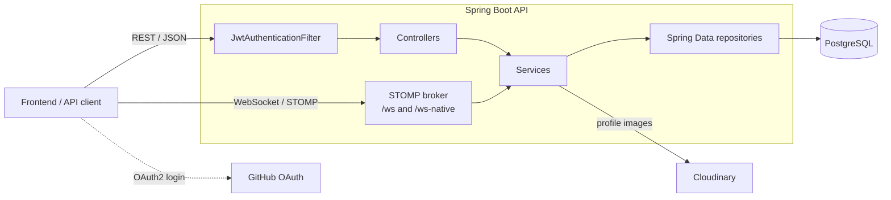
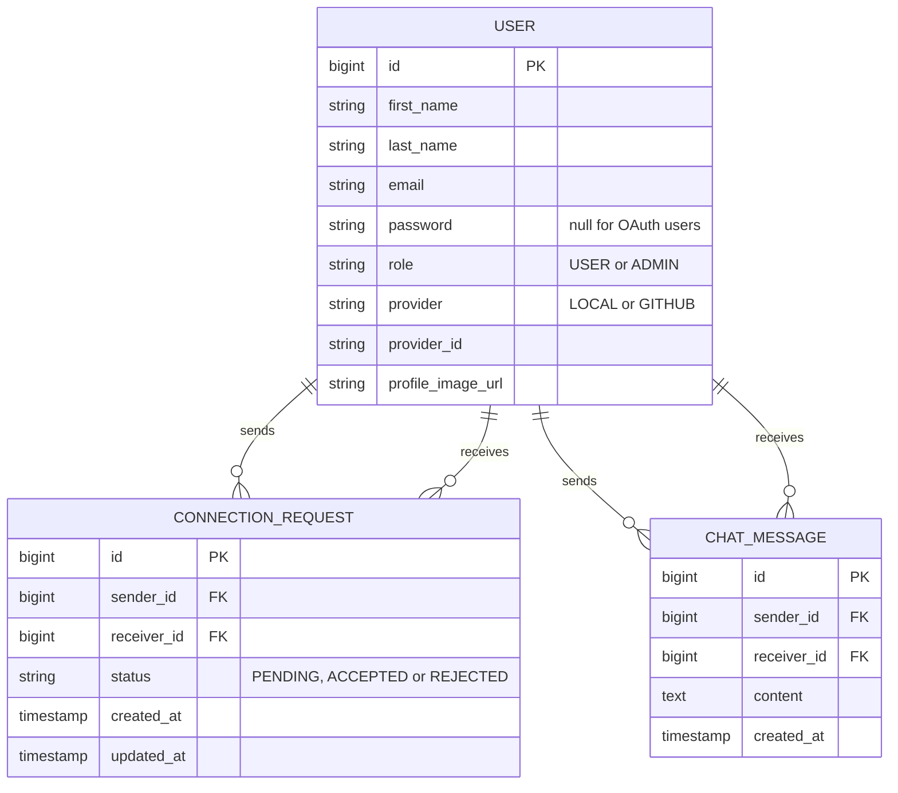

# DeveloperNetwork


A backend for a developer networking platform. Developers can sign up (with email or GitHub), build a profile, discover other developers, send and accept connection requests, and chat with their connections in real time.

The API is built with Spring Boot using a layered architecture, secured with stateless JWT authentication, backed by PostgreSQL, and ships with a Docker Compose setup.

> **Note:** This repository contains the **backend only**. The OAuth2 flow is wired to redirect to a frontend dev server at `http://localhost:5173` (a Vite-style default), but no frontend code lives here.

---

## Table of contents

- [Features](#features)
- [Tech stack](#tech-stack)
- [Architecture](#architecture)
- [Project structure](#project-structure)
- [Getting started](#getting-started)
  - [Prerequisites](#prerequisites)
  - [Configuration](#configuration)
  - [Run locally](#run-locally)
  - [Run with Docker Compose](#run-with-docker-compose)
  - [GitHub OAuth setup](#github-oauth-setup)
- [API reference](#api-reference)
- [Real-time messaging](#real-time-messaging)
- [Data model](#data-model)
- [Error format](#error-format)
- [Roadmap](#roadmap)
- [Author](#author)

---

## Features

- **Email + password authentication** with BCrypt password hashing and Bean Validation on all inputs.
- **GitHub social login** (OAuth2). Existing accounts with a matching email are linked automatically; new users are created on first login.
- **Stateless JWT sessions**, accepted from either an `HttpOnly` cookie (web clients) or an `Authorization: Bearer` header (Postman, cURL, mobile). Tokens are valid for 24 hours.
- **Profiles** with first name, last name and a profile picture uploaded to **Cloudinary** (max 5 MB per file).
- **Discovery feed** that suggests developers you are not yet connected to and have no pending request with.
- **Connection requests**: send, list incoming, accept or reject. One request per pair of users, in either direction.
- **Real-time 1:1 chat** over WebSocket/STOMP, plus a REST endpoint for sending messages and loading history. Messaging is restricted to **accepted connections**.
- **Keyset (cursor) pagination** for chat history, backed by a composite index on `(sender_id, receiver_id, created_at)`.
- **DTO-based API contracts**: JPA entities are never exposed directly.
- **Centralised error handling** with a consistent JSON error body.

## Tech stack

| Area | Technology |
|:--|:--|
| Language / runtime | Java 21 |
| Framework | Spring Boot 4.1.1 (Spring MVC, Spring Data JPA, Bean Validation) |
| Security | Spring Security, JJWT 0.11.5 (HS256), BCrypt, OAuth2 Client (GitHub) |
| Real-time | Spring WebSocket, STOMP with an in-memory simple broker, SockJS fallback |
| Database | PostgreSQL 17, Hibernate ORM |
| File storage | Cloudinary (`cloudinary-http44` 1.36.0) |
| Build | Maven (wrapper included), Lombok |
| Deployment | Docker, Docker Compose |

## Architecture



Request flow: the JWT filter authenticates each request and places the `User` into the security context. Controllers receive it via `@AuthenticationPrincipal`, delegate to services (where business rules live), which use repositories to talk to PostgreSQL and map results to response DTOs.

## Project structure

```text
.
├── Dockerfile
├── compose.yml
├── pom.xml
├── mvnw / mvnw.cmd
└── src/main
    ├── java/com/network/developer
    │   ├── DeveloperApplication.java
    │   ├── config/        # Security, WebSocket, OAuth2 success handler, Cloudinary, auth beans
    │   ├── controller/    # Auth, User, Connection, Chat (REST) and ChatWebsocket (STOMP)
    │   ├── dto/           # Request/response objects: auth, chat, connection, user, error
    │   ├── entity/        # User, ConnectionRequest, ChatMessage + enums
    │   ├── exception/     # GlobalExceptionHandler, UserAlreadyExistsException
    │   ├── repository/    # UserRepository, ConnectionRequestRepository, ChatMessageRepository
    │   ├── security/      # JwtService, JwtAuthenticationFilter, WebsocketAuthInterceptor
    │   └── service/       # AuthenticationService, UserService, ConnectionService, ChatService, CloudinaryService
    └── resources/
        └── application.yml
```

## Getting started

### Prerequisites

- JDK 21
- PostgreSQL 17 (or any recent version), or Docker
- A [Cloudinary](https://cloudinary.com/) account (for profile image uploads)
- A [GitHub OAuth App](https://github.com/settings/developers) (for social login)

### Configuration

`application.yml` reads its secrets from environment variables. **All of the following must be set**, otherwise the application will fail to start.

| Variable | Description |
|:--|:--|
| `DB_USERNAME` | PostgreSQL username (local run) |
| `DB_PASSWORD` | PostgreSQL password (local run) |
| `APP_SECRET_KEY` | **Base64-encoded** HMAC key used to sign JWTs. Must decode to at least 32 bytes. |
| `GITHUB_CLIENT_ID` | GitHub OAuth App client ID |
| `GITHUB_CLIENT_SECRET` | GitHub OAuth App client secret |
| `CLOUDINARY_CLOUD_NAME` | Cloudinary cloud name |
| `CLOUDINARY_CLOUD_KEY` | Cloudinary API key |
| `CLOUDINARY_API_SECRET` | Cloudinary API secret |

Optional overrides (Spring property names, or their `UPPER_SNAKE_CASE` environment equivalents):

| Property | Default | Description |
|:--|:--|:--|
| `app.oauth2.redirect-uri` | `http://localhost:5173/oauth2/redirect` | Where users are sent after a successful GitHub login |
| `jwt.cookie.secure` | `false` | Set to `true` when serving over HTTPS so the cookie is only sent on secure connections |

Generate a suitable JWT secret with:

```bash
openssl rand -base64 32
```

Other defaults worth knowing: the local datasource points at `jdbc:postgresql://localhost:5432/developer_network`, Hibernate runs with `ddl-auto: update` (tables are created and updated automatically), and uploads are capped at 5 MB per file / 7 MB per request.

### Run locally

1. Create the database:

   ```bash
   createdb developer_network
   ```

2. Export the environment variables:

   ```bash
   export DB_USERNAME=postgres
   export DB_PASSWORD=your_password
   export APP_SECRET_KEY=$(openssl rand -base64 32)
   export GITHUB_CLIENT_ID=your_github_client_id
   export GITHUB_CLIENT_SECRET=your_github_client_secret
   export CLOUDINARY_CLOUD_NAME=your_cloud_name
   export CLOUDINARY_CLOUD_KEY=your_api_key
   export CLOUDINARY_API_SECRET=your_api_secret
   ```

3. Start the API:

   ```bash
   ./mvnw spring-boot:run        # macOS / Linux
   mvnw.cmd spring-boot:run      # Windows
   ```

The API is now available at `http://localhost:8080`.

### Run with Docker Compose

`compose.yml` starts two services: the API (`connectify-backend`, port `8080`) and a PostgreSQL 17 container (`connectify-database`, port `5432`) with a persistent `postgres_data` volume and a health check. The API waits until the database is healthy.

The `Dockerfile` copies a pre-built jar, so **build the jar first**:

```bash
./mvnw clean package -DskipTests
```

Compose already provides the database connection settings. The remaining secrets must be passed to the API container. Create a `.env` file (and keep it out of version control):

```bash
APP_SECRET_KEY=...
GITHUB_CLIENT_ID=...
GITHUB_CLIENT_SECRET=...
CLOUDINARY_CLOUD_NAME=...
CLOUDINARY_CLOUD_KEY=...
CLOUDINARY_API_SECRET=...
```

Then reference it from the `app` service in `compose.yml`:

```yaml
services:
  app:
    env_file:
      - .env
```

Start everything:

```bash
docker compose up --build
```

> The sample database credentials in `compose.yml` are for local development only. Change them before deploying anywhere shared.

### GitHub OAuth setup

1. Go to **GitHub → Settings → Developer settings → OAuth Apps → New OAuth App**.
2. Set the **Authorization callback URL** to:

   ```text
   http://localhost:8080/login/oauth2/code/github
   ```

3. Copy the client ID and secret into `GITHUB_CLIENT_ID` and `GITHUB_CLIENT_SECRET`.
4. Start the login flow by sending the browser to:

   ```text
   http://localhost:8080/oauth2/authorization/github
   ```

On success the API sets the `jwt` cookie (`HttpOnly`, `SameSite=Lax`, 24 hours) and redirects to `app.oauth2.redirect-uri`. If a GitHub user keeps their email private, a placeholder `<login>@users.noreply.github.com` address is used.

## API reference

Base URL: `http://localhost:8080`

All endpoints except those under `/api/v1/auth/**`, `/oauth2/**`, `/login/oauth2/**` and the WebSocket endpoints require authentication. Authenticate with either:

- the `jwt` cookie set by the auth endpoints, or
- an `Authorization: Bearer <token>` header.

### Authentication

| Method | Endpoint | Body | Description |
|:--|:--|:--|:--|
| `POST` | `/api/v1/auth/register` | `{ firstName, lastName, email, password }` | Create an account. Returns `{ status, message, token }` and sets the `jwt` cookie. |
| `POST` | `/api/v1/auth/authenticate` | `{ email, password }` | Log in. Returns `{ status, message, token }` and sets the `jwt` cookie. |
| `GET` | `/oauth2/authorization/github` | none | Start GitHub login. |

Validation rules: email must be valid (max 100 chars); password 8 to 100 chars; first name 2 to 50 chars; last name 1 to 50 chars.

### Users

| Method | Endpoint | Body | Description |
|:--|:--|:--|:--|
| `GET` | `/api/v1/users/profile` | none | Get the current user's profile. |
| `PATCH` | `/api/v1/users/profile` | `multipart/form-data`: `firstName`, `lastName`, `profileImage` (all optional) | Update profile fields and/or upload a profile image to Cloudinary. |

### Connections

| Method | Endpoint | Description |
|:--|:--|:--|
| `GET` | `/api/v1/connection/feed?page=0&size=10` | Suggested developers (excludes yourself and anyone with a pending or accepted request with you). Returns user cards: `id`, `firstName`, `lastName`, `profileImageUrl`. |
| `POST` | `/api/v1/connection/send/{receiverId}` | Send a connection request. |
| `GET` | `/api/v1/connection/requests/received` | List users who have sent you a pending request. |
| `POST` | `/api/v1/connection/requests/{requestId}/review?action=ACCEPT` | Accept (`ACCEPT`) or reject (`REJECT`) a request addressed to you. |

### Chat (REST)

| Method | Endpoint | Description |
|:--|:--|:--|
| `POST` | `/api/v1/chat/send` | Send a message. Body: `{ "receiverId": 2, "content": "Hello!" }`. Returns the saved message. |
| `GET` | `/api/v1/chat/history?size=30` | Load history with one connection. Body: `{ "otherUserId": 2, "lastSeenTime": "...", "lastSeenId": 123 }`. |

Chat rules:

- Both users must have an **accepted** connection, otherwise the request fails with `409`.
- `size` must be between 1 and 100 (default 30).
- History is paginated with a cursor. Omit `lastSeenTime` and `lastSeenId` to get the latest messages; pass the `createdAt` and `id` of the oldest message you have to get the previous page. The two cursor fields must be supplied together. Each page is returned in chronological order.
- This endpoint reads its cursor from a JSON **request body** on a `GET`, which works from Postman and cURL but is not supported by some HTTP clients (including the browser `fetch` API).

### Example

```bash
# Register
curl -X POST http://localhost:8080/api/v1/auth/register \
  -H "Content-Type: application/json" \
  -d '{"firstName":"Ada","lastName":"Lovelace","email":"ada@example.com","password":"supersecret1"}'

# Use the returned token
curl http://localhost:8080/api/v1/users/profile \
  -H "Authorization: Bearer <token>"

# Send a connection request to user 2
curl -X POST http://localhost:8080/api/v1/connection/send/2 \
  -H "Authorization: Bearer <token>"
```

## Real-time messaging

Chat uses STOMP over WebSocket with an in-memory broker.

| Item | Value |
|:--|:--|
| SockJS endpoint (browsers) | `/ws` |
| Native WebSocket endpoint (Postman, native clients) | `/ws-native` |
| Authentication | `Authorization: Bearer <token>` STOMP header on the `CONNECT` frame |
| Send messages to | `/app/chat.send` |
| Receive messages on | `/user/queue/message` |

Send payload: `{ "receiverId": 2, "content": "Hello!" }`. The recipient receives a message object `{ id, senderId, receiverId, content, createdAt }` on their private queue. Messages are persisted before delivery, and the same connection rules as the REST endpoint apply.

Example with [`@stomp/stompjs`](https://github.com/stomp-js/stompjs):

```js
import { Client } from "@stomp/stompjs";

const client = new Client({
  brokerURL: "ws://localhost:8080/ws-native",
  connectHeaders: { Authorization: `Bearer ${token}` },
  onConnect: () => {
    client.subscribe("/user/queue/message", (frame) => {
      console.log("New message:", JSON.parse(frame.body));
    });

    client.publish({
      destination: "/app/chat.send",
      body: JSON.stringify({ receiverId: 2, content: "Hello!" }),
    });
  },
});

client.activate();
```

## Data model



Table names are `_user`, `connection_requests` and `chat_message`. `connection_requests` has a unique constraint on `(sender_id, receiver_id)`, and `chat_message` has the composite index `idx_chat_sender_receiver_message` on `(sender_id, receiver_id, created_at)`.

## Error format

Errors are returned as JSON by a global exception handler:

```json
{
  "status": 400,
  "error": "Validation Failed",
  "message": "...",
  "path": "/api/v1/auth/register",
  "timestamp": "2026-01-01T12:00:00",
  "validationErrors": {
    "email": "Please provide a valid email address"
  }
}
```

`validationErrors` is only present for validation failures.

| Status | When |
|:--|:--|
| `400` | Validation failed, or an invalid argument (for example an unknown user or invalid `action`) |
| `401` | Bad credentials |
| `409` | Email already registered, duplicate or already-accepted connection request, messaging a non-connection, or reviewing a request that is not yours or already handled |
| `500` | Unexpected server error |

## Roadmap

- Add unit and integration tests (the generated context-load test is currently commented out).
- Replace `ddl-auto: update` with versioned migrations (Flyway or Liquibase).
- Make the `Dockerfile` multi-stage so the image can be built without a local Maven build.
- Move Compose credentials into an `.env` file and add an `env_file` entry for the application secrets.
- Add OpenAPI / Swagger documentation.
- Publish the frontend client and link it here.

## License

No license has been specified yet. Add a `LICENSE` file (for example MIT or Apache-2.0) to make the reuse terms clear.

## Author

Built by [AR-JUN-G](https://github.com/AR-JUN-G).
